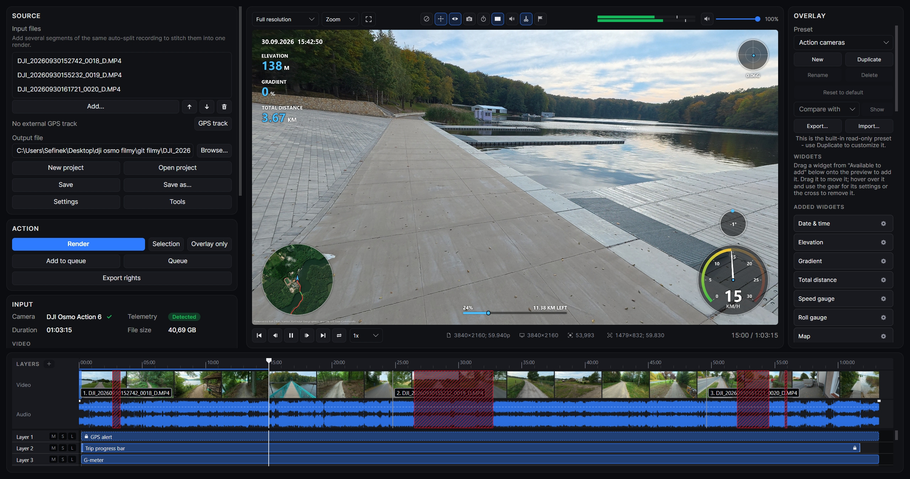

# Telemavix Studio (formerly OsmoOverlay) ✨
Add a modern telemetry HUD (speed, map, route, tilt and more) to DJI Osmo, GoPro and DJI drone footage using camera telemetry, DJI flight logs and optional external GPS tracks. Videos are re-encoded with the source's codec and settings to keep the result as close to the original as possible.

If you find this repository useful, I would greatly appreciate it if you could give it a **star** ⭐. Thank you!
Using Telemavix Studio in your videos? A mention (e.g. in your YouTube video description) would make my day 💖
Pull requests are welcome too - bug fixes, new widgets, support for other cameras, anything that makes the app better.



## Documentation and downloads

User documentation is maintained on the [Telemavix website](https://sefinek.net/projects/telemavix). [Polska wersja](https://sefinek.net/pl/projects/telemavix).

- [Features](https://sefinek.net/projects/telemavix#features)
- [Download](https://sefinek.net/projects/telemavix#download)
- [Installation: Windows, Linux and macOS](https://sefinek.net/projects/telemavix#installation)
- [Hardware and software requirements](https://sefinek.net/projects/telemavix#requirements)
- [Supported devices](https://sefinek.net/projects/telemavix#devices)
- [Camera telemetry and limitations](https://sefinek.net/projects/telemavix#camera-telemetry)
- [DJI flight logs](https://sefinek.net/projects/telemavix#dji-drones)
- [Adding and synchronizing a GPS track](https://sefinek.net/projects/telemavix#gps-tracks)
- [Command line and render queue](https://sefinek.net/projects/telemavix#command-line)
- [Video quality and privacy](https://sefinek.net/projects/telemavix#video-quality)
- [Reviews and mentions](https://sefinek.net/projects/telemavix#reviews)
- [License and commercial use](https://sefinek.net/projects/telemavix#license)

## Building from source
Requires the [.NET 10 SDK](https://dotnet.microsoft.com/download/dotnet/10.0).

```sh
dotnet run --project Telemavix.Gui                     # run the app
dotnet test --project Telemavix.Tests                  # run the unit tests
dotnet run --project Telemavix.Build                   # build every release package into artifacts/
dotnet run --project Telemavix.Build -- --help         # options: platforms, variant, version, output directory
```
Packages for all platforms can be built on any system (Windows, Linux or macOS).

BugSnag reporting is enabled only in Release builds compiled with the `BUGSNAG_API_KEY` environment variable set. The key is embedded at build time; it is not needed on the user's machine. The Release workflow reads it from the repository's `BUGSNAG_API_KEY` Actions secret. Builds without a key, Debug builds and GUI smoke tests do not send reports. Users can disable reporting in Settings > Privacy.

## License

[PolyForm Noncommercial License 1.0.0](LICENSE). See [Licensing and video publication](LICENSING.md) for examples and third-party obligations, and the [website](https://sefinek.net/projects/telemavix#license) for a summary and contact details.
